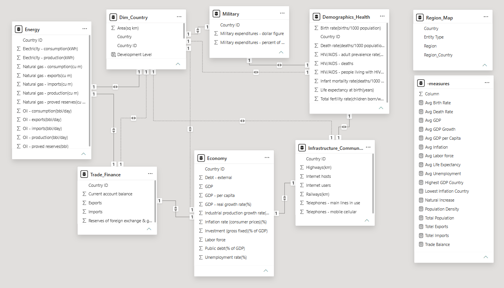
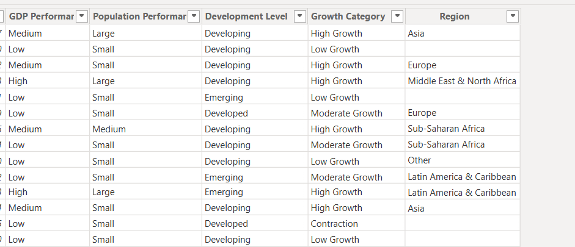
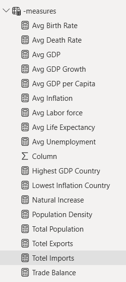
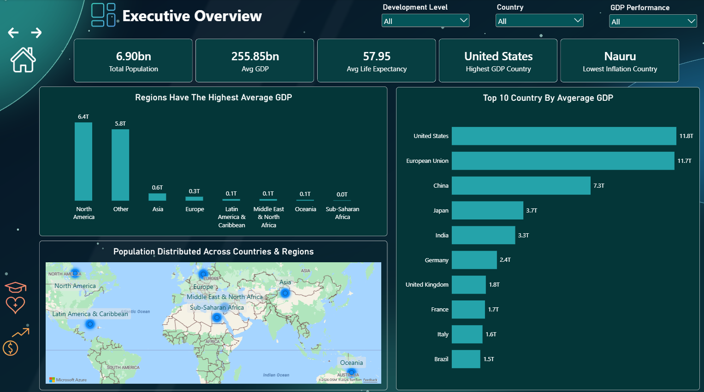
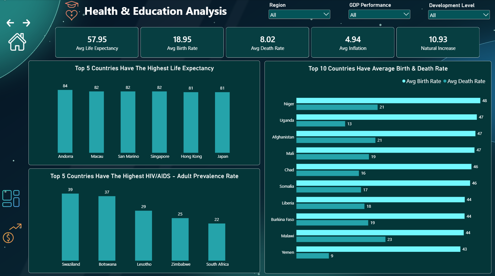
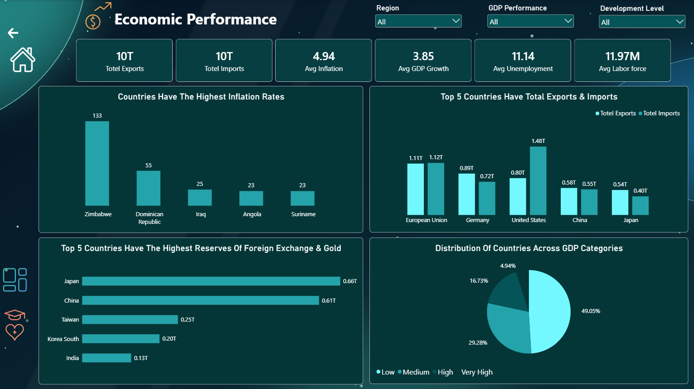

# Global Country Analytics | Power BI Dashboard

An interactive Power BI dashboard that compares countries and regions across the economy, trade, inflation, demographics, and health. It is built on a multi-table data model with custom calculated columns and DAX measures.

## Data Preparation

The raw data came as **one single wide table named `Country Global`**, with one row per country and every indicator mixed together: economy, demographics and health, trade, energy, infrastructure, and military.

To make the model cleaner and easier to work with, I **split this single table into separate tables by subject**. Each new table keeps **Country ID** as its key, so the tables can be linked back to the country list:

| Original table | Split into |
|---|---|
| `Country Global` (one flat table) | Dim_Country, Economy, Demographics_Health, Trade_Finance, Energy, Infrastructure_Communications, Military |

I then added a **Region_Map** lookup table to assign regions, and a dedicated **-measures** table to hold all DAX measures.

Splitting the data this way makes each table focused on one topic, keeps the model easier to understand, and gives it clear relationships between tables instead of one very wide table.

## About the Project

This project combines country-level indicators from several tables (economy, demographics and health, trade and finance, energy, infrastructure and communications, and military) into one model and a three-page dashboard that answers questions such as:

- Which countries and regions have the largest economies?
- Who are the biggest exporters and importers, and who runs a trade deficit?
- Which countries suffer from the highest inflation?
- Where is life expectancy highest, and where are birth rates and HIV/AIDS prevalence highest?
- How are countries distributed across GDP categories?

## Tools Used

- Power BI Desktop
- Data modeling (splitting one flat table into multiple related tables linked by Country ID)
- DAX (calculated columns and measures)
- Interactive slicers (Region, Country, GDP Performance, Development Level)
- Map visual, page navigation buttons, and a custom dark theme

## Data Model

After the split, the model has one dimension table, **Dim_Country**, linked to the other tables through **Country ID** with one-to-one relationships.

| Table | What it contains |
|---|---|
| **Dim_Country** | Country name, area, Country ID, and the calculated classification columns |
| **Economy** | GDP, GDP per capita, real GDP growth, inflation, unemployment, labor force, public and external debt, investment |
| **Demographics_Health** | Birth rate, death rate, life expectancy, infant mortality, fertility rate, HIV/AIDS indicators |
| **Trade_Finance** | Exports, imports, current account balance, reserves of foreign exchange and gold |
| **Energy** | Electricity, oil, and natural gas production, consumption, imports, exports, and reserves |
| **Infrastructure_Communications** | Highways, railways, internet users and hosts, telephone lines |
| **Military** | Military expenditures (dollar figure and percent of GDP) |
| **Region_Map** | A lookup table I added to assign each country or entity to a region |
| **-measures** | A dedicated table that holds all DAX measures |

## Calculated Columns

I created calculated columns to group countries into categories that are easy to filter and compare:

| Column | Categories |
|---|---|
| **GDP Performance** | Low, Medium, High, Very High |
| **Population Performance** | Small, Medium, Large |
| **Development Level** | Developing, Emerging, Developed |
| **Growth Category** | Contraction, Low Growth, Moderate Growth, High Growth |
| **Region** | Asia, Europe, North America, Latin America & Caribbean, Middle East & North Africa, Sub-Saharan Africa, Oceania, Other (taken from the Region_Map table) |

## DAX Measures

| Measure | Description |
|---|---|
| Total Population | Total population of the selected countries |
| Population Density | Population relative to land area |
| Avg GDP | Average GDP across countries |
| Avg GDP per Capita | Average GDP per person |
| Avg GDP Growth | Average real GDP growth rate (%) |
| Avg Inflation | Average consumer price inflation (%) |
| Avg Unemployment | Average unemployment rate (%) |
| Avg Labor Force | Average size of the labor force |
| Avg Life Expectancy | Average life expectancy at birth (years) |
| Avg Birth Rate | Average births per 1,000 people |
| Avg Death Rate | Average deaths per 1,000 people |
| Natural Increase | Birth rate minus death rate |
| Total Exports | Total value of exports |
| Total Imports | Total value of imports |
| Trade Balance | Exports minus imports |
| Highest GDP Country | The country with the highest GDP in the current selection |
| Lowest Inflation Country | The country with the lowest inflation in the current selection |

## Dashboard Pages

### 1. Home

A landing page with navigation buttons to the three report pages.

### 2. Executive Overview

**Slicers:** Development Level, Country, GDP Performance

**KPIs:** Total Population (6.90bn), Avg GDP (255.85bn), Avg Life Expectancy (57.95), Highest GDP Country (United States), Lowest Inflation Country (Nauru)

**Visuals:**
- Regions with the Highest Average GDP
- Top 10 Countries by Average GDP
- Population Distributed Across Countries and Regions (map)

### 3. Health & Education Analysis

**Slicers:** Region, GDP Performance, Development Level

**KPIs:** Avg Life Expectancy (57.95), Avg Birth Rate (18.95), Avg Death Rate (8.02), Avg Inflation (4.94), Natural Increase (10.93)

**Visuals:**
- Countries with the Highest Life Expectancy
- Top 5 Countries with the Highest HIV/AIDS Adult Prevalence Rate
- Top 10 Countries by Average Birth and Death Rate

### 4. Economic Performance

**Slicers:** Region, GDP Performance, Development Level

**KPIs:** Total Exports (10T), Total Imports (10T), Avg Inflation (4.94), Avg GDP Growth (3.85), Avg Unemployment (11.14), Avg Labor Force (11.97M)

**Visuals:**
- Countries with the Highest Inflation Rates
- Top 5 Countries by Total Exports and Imports
- Top 5 Countries with the Highest Reserves of Foreign Exchange and Gold
- Distribution of Countries Across GDP Categories

## Key Insights

### Global economy
- The **United States** has the largest GDP (**11.8T**), followed closely by the **European Union** as a single entity (**11.7T**), then **China (7.3T)**, **Japan (3.7T)**, and **India (3.3T)**. Germany (2.4T), the UK (1.8T), France (1.7T), Italy (1.6T), and Brazil (1.5T) complete the top 10.
- Economic size is highly concentrated by region: **North America (6.4T)** has by far the highest average GDP, far above **Asia (0.6T)** and **Europe (0.3T)**, while **Sub-Saharan Africa** is close to zero in comparison.
- Almost half of all countries (**49.05%**) fall in the **Low** GDP category, 29.28% are **Medium**, 16.73% are **High**, and only **4.94%** are **Very High**.
- Global averages are **3.85%** for GDP growth, **4.94%** for inflation, and **11.14%** for unemployment.

### Trade and finance
- Total global exports and imports are both about **10T**.
- The **United States** is the largest importer (**1.48T**) and runs the biggest trade deficit among the top five traders, about **0.68T** (exports of 0.80T). **Germany**, **Japan**, and **China** all run surpluses.
- The **European Union** trades the most in both directions, with about **1.11T** in exports and **1.12T** in imports.
- **Japan (0.66T)** and **China (0.61T)** hold by far the largest reserves of foreign exchange and gold, well ahead of Taiwan (0.25T), South Korea (0.20T), and India (0.13T).
- **Zimbabwe** has the highest inflation (**133%**), more than double the Dominican Republic (55%) and far above the global average of 4.94%. Iraq (25%), Angola (23%), and Suriname (23%) follow.

### Health and demographics
- The countries with the highest life expectancy are mostly small and wealthy: **Andorra (84 years)**, then Macau, San Marino, and Singapore (82), and Hong Kong and Japan (81).
- HIV/AIDS prevalence is concentrated in southern Africa: **Swaziland (39%)**, **Botswana (37%)**, **Lesotho (29%)**, **Zimbabwe (25%)**, and **South Africa (22%)**.
- The highest birth rates are above **43 per 1,000 people** and are led by **Niger (48)**, then Uganda, Afghanistan, and Mali (47). That is **more than double** the global average of 18.95.
- The average birth rate (**18.95**) exceeds the average death rate (**8.02**), giving a natural increase of **10.93 per 1,000**.
- Among the ten highest-birth-rate countries, **Uganda and Yemen** grow fastest naturally (about 34 per 1,000), while **Malawi** has the highest death rate (23), which slows its growth.
